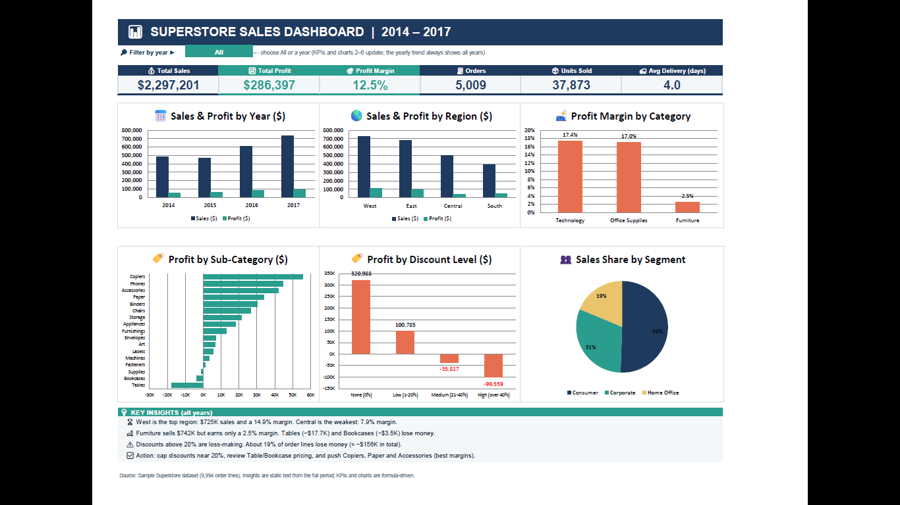
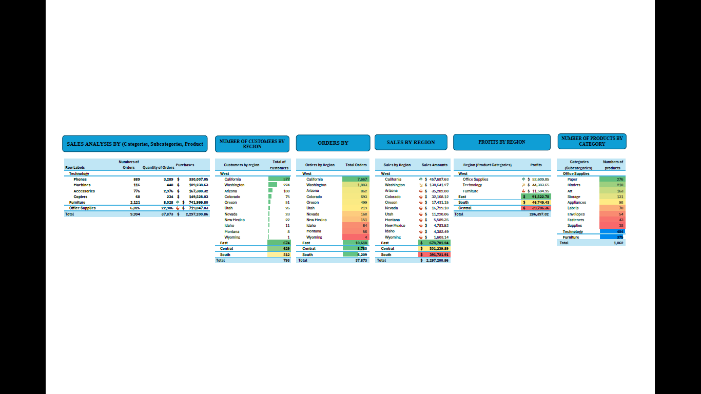
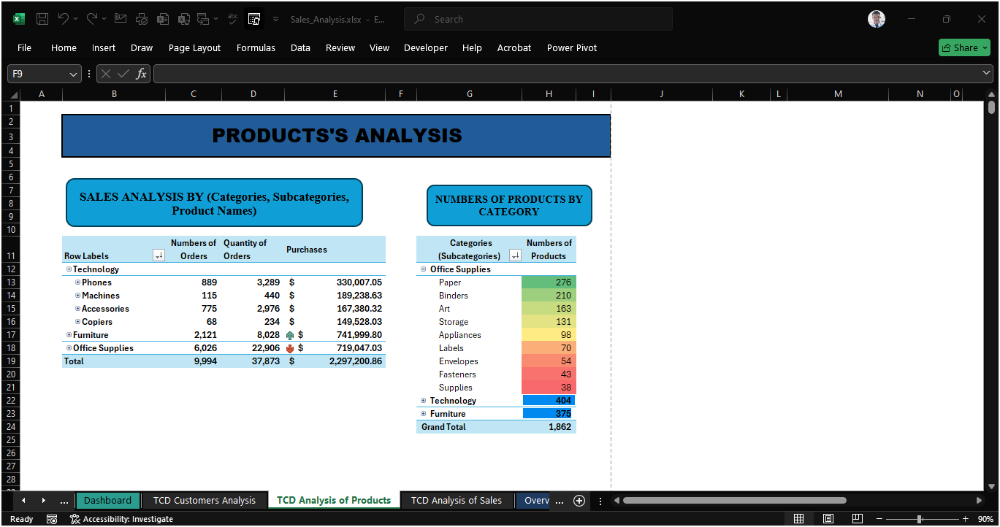

# superstore-sales-analysis-excel
Sales, customers and products analysis in Excel

# Superstore Sales Analysis (Excel)

> **Project overview sheet** — Sales, customers and products analysis of a US retail dataset (Sample Superstore) built with Excel Tables, formulas and PivotTables.

| | |
|---|---|
| **🎯 Objective** | Understand where sales come from, who the best customers are, which products create (or destroy) profit, and how regions perform over time.|
| **🛠️ Tool** | Microsoft Excel: formulas, SUMIFS / COUNTIFS, data validation (year filter), charts. PivotTables are in the companion workbook (Sales_Analysis.xlsx).
| **Deliverable** | [`data/Sales_Analysis.xlsx`](data/Sales_Analysis.xlsx) |

---

## 1. Business context

A retail company selling **Furniture, Office Supplies and Technology** to Consumer, Corporate and Home Office customers wants to understand **where sales come from, who its best customers are, which products drive (or destroy) profit**, and how it performs across regions and over time.

## 2. Objectives

1. Analyse **sales and profit** by region, state, category and sub-category.
2. Profile **customers**: distribution by region, evolution over time, top customers by order quantity and by purchase amount.
3. Analyse the **product catalogue**: number of products per category / sub-category and contribution to sales.
4. Identify **profitability issues** to support decisions.

## 3. Dataset

One Excel Table (`Sample___Superstore`) with 25 columns: order, customer, geography, product, segment, shipping, dates, sales, quantity, discount, profit.
Description of the Dataset:

| Metric | Value |
|---|---|
| Order lines | 9,994 |
| Unique orders | 5,009 |
| Customers | 793 |
| Products | 1,862 |
| States / Cities | 49 / 531 |
| Period | 2014-01-03 → 2017-12-30 |
| Total sales | **$2,297,201** |
| Total profit | **$286,397** (12.5 % margin) |
| Total quantity sold | 37,873 units |

## 4. Workbook structure

| Sheet | Content |
|---|---|
| `Sample - Superstore` | Cleaned source data (Excel Table) + calculated columns: order day / month / year, delivery day, **delivery lead time** (`DAYS`) |
| `Dashbord` | OverView Of the Activity |
| `TCD Customers Analysis` | Customers by region, customers over time, top 10 customers by quantity and by purchases (filter on year) |
| `TCD Analysis of Products` | Orders, quantity and sales by category; number of products per sub-category |
| `TCD Analysis of Sales` | Customers, orders, sales by region → state; profit by region and category |

## 5. Method

1. Import the raw Superstore data and convert it to an **Excel Table**.
2. Rename columns (French labels) and add **calculated columns** with formulas (`TEXT`, `DAYS`) for day, month, year and delivery lead time.
3. Check data quality (no missing values in the 25 columns, no duplicate rows).
4. Build **PivotTables** per analysis axis (customers, products, sales) and filter by year.
5. Read the results and extract insights.

## 6. Key insights

**Overall performance**

- Sales grew from **$484K (2014)** to **$733K (2017)** (+51 %). Profit margin stayed around 10–13 %.

**Regions**
- **West** is #1 in sales ($725K) and margin (14.9 %); **East** follows ($679K, 13.5 %).
- **Central** is the weakest in profitability: 7.9 % margin on $501K sales.

 

**Categories**
- **Technology** ($836K) and **Office Supplies** ($719K) generate 94 % of profit.
- **Furniture** sells a lot ($742K) but earns almost nothing: **2.5 % margin**.

**Sub-categories**
- Loss-making: **Tables (−$17.7K)**, **Bookcases (−$3.5K)**, **Supplies (−$1.2K)**.
- Best profit: **Copiers, Phones, Accessories, Paper**.

**Discounts**
- Lines with **no discount** earn a 29.5 % margin; lines with a discount **above 20 %** are loss-making (−15 % to −77 % margin). About **19 % of order lines lose money** (≈ −$156K in total).
- Texas, Ohio, Pennsylvania and Illinois are the states with the largest cumulative losses.

**Shipping**
- Average delivery lead time is **4 days** (Same Day 0, First Class 2.2, Second Class 3.2, Standard 5.0). Standard Class represents 59 % of order lines.

## 7. Recommendations

1. **Cap discounts at ~20 %**, especially on Furniture (Tables, Bookcases).
2. **Review pricing / supplier cost** of Tables and Bookcases.
3. Investigate **Central region** (Texas, Illinois) where discounting hurts margin.
4. Push high-margin lines (Copiers, Paper, Accessories) in marketing.

## 10. How to use

1. Download or clone the repo.
2. Open `data/Sales_Analysis.xlsx` in Excel.
3. Go to the `TCD …` sheets and use the filters / slicers to explore.

**Jean Rodrigue Awono** — [LinkedIn](https://www.linkedin.com/)
